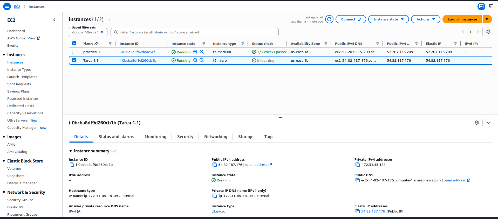
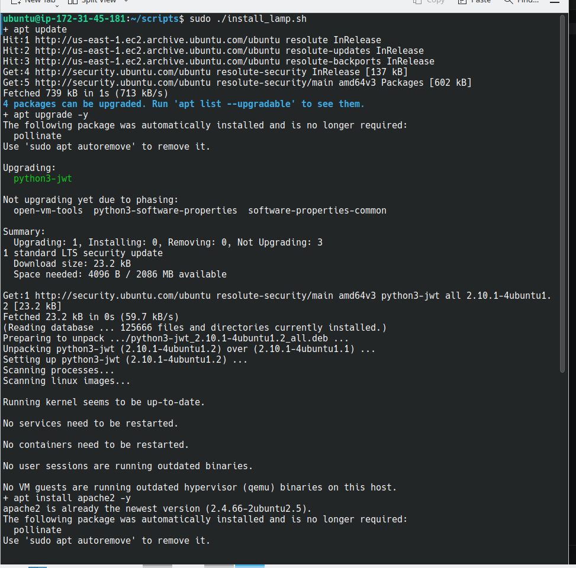
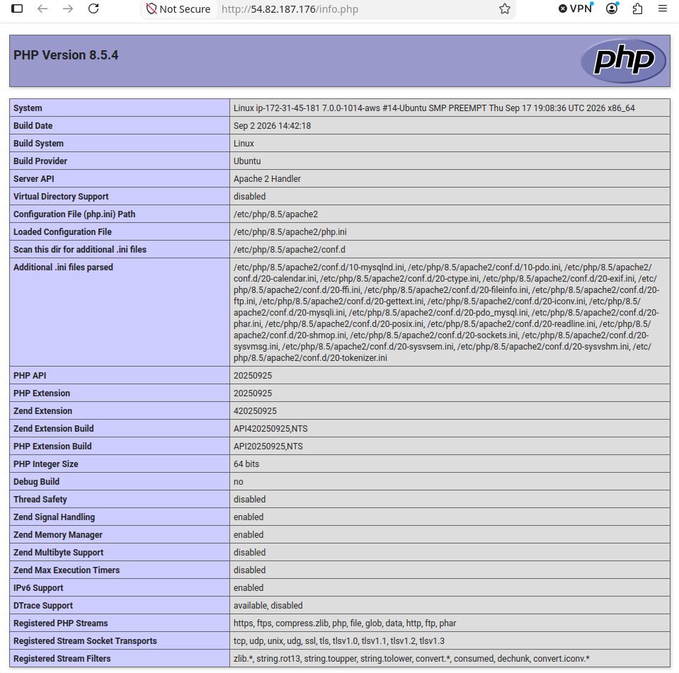
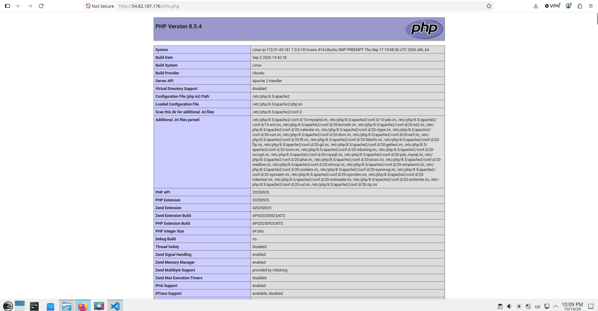
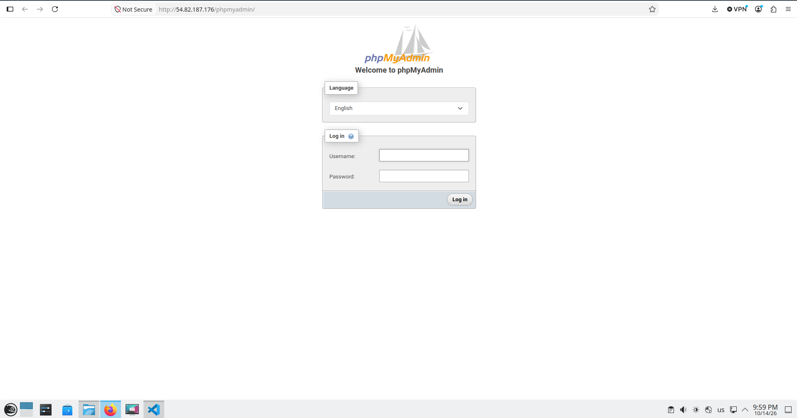
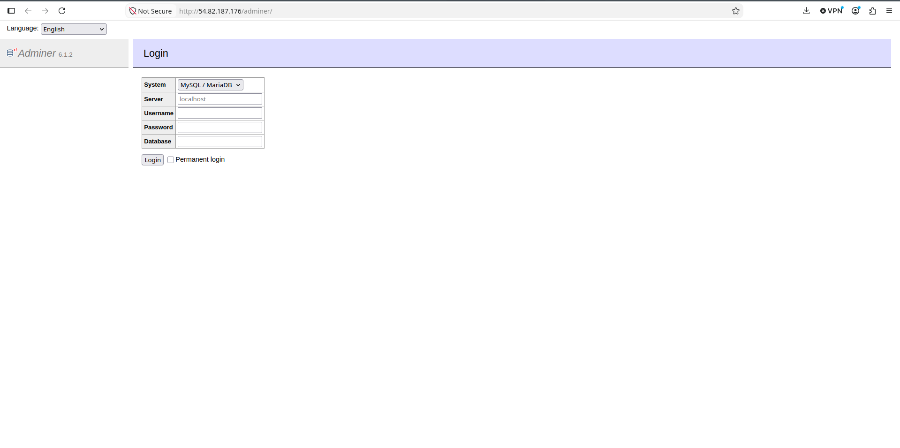
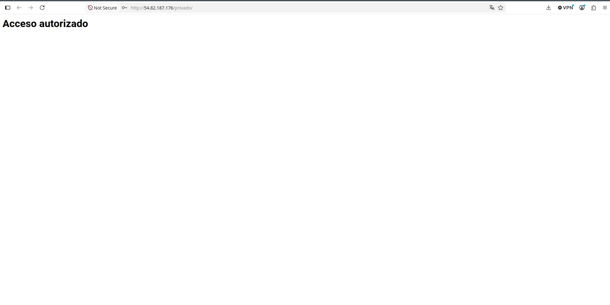

# Práctica 1.1: Instalación de la pila LAMP en AWS y herramientas adicionales

Este documento describe la instalación automatizada de Apache HTTP Server, PHP y MySQL Server en una instancia AWS con Ubuntu Server, además de phpMyAdmin, Adminer, GoAccess y el control de acceso a un directorio mediante `.htaccess`.

## 1. Datos de la infraestructura en AWS

Para esta práctica se ha utilizado una instancia EC2 de Amazon Web Services con Ubuntu Server 22.04 LTS.

- **Nombre de la instancia:** `tarea-1.1`
- **Tipo de instancia:** `t3.medium`
- **Sistema operativo:** Ubuntu Server 22.04 LTS
- **IP pública:** `54.82.187.176`  
- **Usuario SSH:** `ubuntu`
- **Clave privada:** `vockey.pem`

El grupo de seguridad permite el tráfico necesario para administrar y probar el servidor:

- **SSH:** TCP, puerto 22. Por seguridad, limitar el origen a la IP del administrador.
- **HTTP:** TCP, puerto 80.
- **HTTPS:** TCP, puerto 443, si se configura TLS.

No se debe abrir el puerto 3306 de MySQL a Internet.



*Figura 1. Instancia EC2 utilizada en la práctica.*

## 2. Instalación automatizada de la pila LAMP

La pila LAMP está compuesta por **Linux**, **Apache HTTP Server**, **MySQL Server** y **PHP**. En esta práctica, Apache, PHP y MySQL se instalan conjuntamente mediante el script `instal_lamp.sh`, en lugar de ejecutar cada instalación manualmente.

### 2.1. Conexión a la instancia

Desde el directorio donde se encuentra la clave privada, ajusta sus permisos y conéctate por SSH. Sustituye la dirección IP si es necesario:

```bash
chmod 400 vockey.pem
ssh -i "vockey.pem" ubuntu@54.82.187.176
```

### 2.2. Ejecución de `instal_lamp.sh`

El script automatiza la actualización del sistema y la instalación de los componentes LAMP. También habilita módulos de Apache, reinicia los servicios y copia la configuración del VirtualHost y la página PHP del proyecto.

El script utiliza rutas relativas como `../conf` y `../php`. Ejecútalo desde el directorio previsto en el proyecto, donde esas rutas correspondan a los directorios de configuración y páginas PHP:

```bash
cd ruta/al/directorio/del/script
sudo bash ./instal_lamp.sh
```

El script incluye acciones equivalentes a las siguientes:

```bash
#!/bin/bash
set -ex

apt update
apt upgrade -y

apt install apache2 -y
cp ../conf/000-default.conf /etc/apache2/sites-available

apt install php libapache2-mod-php php-mysql -y
a2enmod rewrite

systemctl restart apache2
cp ../php/index.php /var/www/html
chown -R www-data:www-data /var/www/html

apt install mysql-server -y
```

Al finalizar, comprueba el estado de los servicios y la versión de PHP:

```bash
sudo systemctl status apache2 --no-pager
sudo systemctl status mysql --no-pager
php --version
```



*Figura 2. Instalación de Apache, PHP y MySQL mediante `instal_lamp.sh`.*

Visita `http://54.82.187.176/` para comprobar que Apache responde y que se muestra la página del proyecto.




*Figura 3. Página de prueba PHP (`phpinfo()`) en el servidor Apache.*

> Si la ejecución del script falla, revisa el mensaje de error y los registros antes de volver a ejecutarlo. No ejecutes una segunda instalación manual de los mismos componentes sin comprobar primero qué instaló el script.

### 2.3. Comprobación de PHP

Para verificar PHP se puede crear temporalmente un archivo de información:

```bash
echo '<?php phpinfo();' | sudo tee /var/www/html/info.php
```

Visita `http://54.82.187.176/info.php`. Una vez realizada la comprobación, elimina el archivo, ya que muestra detalles de la configuración del servidor:

```bash
sudo rm /var/www/html/info.php
```



*Figura 3. Página de prueba PHP (`phpinfo()`) en el servidor Apache.*

## 3. Instalación de herramientas de gestión y monitorización

El script `install_tools.sh` automatiza la instalación de herramientas adicionales: phpMyAdmin, Adminer y GoAccess. Debe ejecutarse desde el directorio previsto por el proyecto:

```bash
cd ruta/al/directorio/del/script
sudo bash ./install_tools.sh
```

### 3.1. phpMyAdmin

phpMyAdmin permite administrar bases de datos MySQL desde una interfaz web. El script instala el paquete y las dependencias de PHP necesarias. La instalación también puede realizarse manualmente:

```bash
sudo apt update
sudo apt install -y phpmyadmin php-mbstring php-zip php-gd php-xml php-curl
```

Si el instalador lo pregunta, selecciona **apache2** como servidor web y confirma la configuración de la base de datos con `dbconfig-common`. Después, recarga Apache:

```bash
sudo systemctl reload apache2
```

Accede a `http://54.82.187.176/phpmyadmin` e inicia sesión con un usuario de MySQL.



*Figura 3. Interfaz de inicio de sesión de phpMyAdmin.*

### 3.2. Adminer

Adminer es una alternativa ligera para administrar bases de datos mediante una aplicación PHP. El script de herramientas lo instala en el directorio web y descarga su archivo PHP. Una instalación equivalente es:

```bash
sudo mkdir -p /var/www/html/adminer
sudo wget -O /var/www/html/adminer/index.php https://www.adminer.org/latest.php
sudo chown -R www-data:www-data /var/www/html/adminer
```

Accede a `http://54.82.187.176/adminer`. En el formulario, selecciona **MySQL**, introduce `localhost` como servidor y proporciona las credenciales de la base de datos.




*Figura 3. Página de prueba PHP (`phpinfo()`) en el servidor Apache.*

*Figura 4. Interfaz de inicio de sesión de Adminer.*

phpMyAdmin y Adminer son interfaces administrativas. En un servidor accesible desde Internet, protégelas mediante HTTPS y restricciones de acceso.

### 3.3. GoAccess: analizador de logs de Apache

GoAccess analiza los registros de acceso de Apache, normalmente ubicados en `/var/log/apache2/access.log`. El script `install_tools.sh` instala la herramienta; también puede instalarse con:

```bash
sudo apt install -y goaccess
```

Para mostrar las estadísticas en la terminal:

```bash
sudo goaccess /var/log/apache2/access.log --log-format=COMBINED
```

Pulsa `q` para salir. Para generar un informe HTML en el directorio personal:

```bash
sudo goaccess /var/log/apache2/access.log \
  --log-format=COMBINED \
  -o "$HOME/informe-goaccess.html"

sudo chown "$USER":"$USER" "$HOME/informe-goaccess.html"
```

El informe puede contener información sobre la actividad del servidor. No lo publiques en el directorio web sin controlar quién puede acceder.

## 4. Control de acceso a un directorio con `.htaccess`

Apache permite controlar el acceso a directorios mediante un archivo `.htaccess`. Esta práctica configura autenticación básica para proteger un directorio del sitio.

### 4.1. Permitir directivas `.htaccess` en Apache

La configuración del VirtualHost utilizada por el proyecto se encuentra en:

```text
/etc/apache2/sites-available/000-default.conf
```


*Figura 3. Página de prueba PHP (`phpinfo()`) en el servidor Apache.*

Comprueba que el bloque `<Directory>` del directorio web permite las directivas de autenticación. Si no existe, añade esta configuración dentro del VirtualHost:

```apache
<Directory /var/www/html>
    AllowOverride AuthConfig
    Require all granted
</Directory>
```

Comprueba la configuración y recarga Apache:

```bash
sudo apache2ctl configtest
sudo systemctl reload apache2


*Figura 3. Página de prueba PHP (`phpinfo()`) en el servidor Apache.*
```

### 4.2. Crear el archivo de contraseñas

Si `htpasswd` no está disponible, instala las herramientas de Apache:

```bash
sudo apt install -y apache2-utils
```

Crea un usuario y guarda su contraseña cifrada fuera del directorio público:

```bash
sudo htpasswd -c /etc/apache2/.htpasswd alumno
```

El comando solicitará una contraseña. Para añadir usuarios posteriormente, ejecuta `htpasswd` sin la opción `-c`, que crea un archivo nuevo:

```bash
sudo htpasswd /etc/apache2/.htpasswd otro_usuario
```

### 4.3. Crear `.htaccess`

Crea el directorio protegido y su archivo `.htaccess`:

```bash
sudo mkdir -p /var/www/html/privado
sudo tee /var/www/html/privado/.htaccess >/dev/null <<'EOF'
AuthType Basic
AuthName "Área restringida - Acceso autorizado"
AuthUserFile /etc/apache2/.htpasswd
Require valid-user
EOF
```

Añade una página de prueba:

```bash
echo '<h1>Acceso autorizado</h1>' | sudo tee /var/www/html/privado/index.html
```

Comprueba la configuración y recarga Apache:

```bash
sudo apache2ctl configtest
sudo systemctl reload apache2
```

Visita `http://54.82.187.176/privado/`. Apache solicitará el usuario y la contraseña creados con `htpasswd`.



*Figura 5. Solicitud de usuario y contraseña para acceder al directorio protegido.*

La autenticación básica debe utilizarse con HTTPS: si se transmite por HTTP, las credenciales no están protegidas durante el envío.

## 5. Comprobaciones finales

Comprueba que Apache y MySQL están activos y que la configuración de Apache es válida:

```bash
sudo systemctl is-active apache2
sudo systemctl is-active mysql
sudo apache2ctl configtest
```

MySQL debe permanecer accesible solo desde la instancia, salvo que exista una necesidad concreta y se hayan configurado controles de red adecuados.


